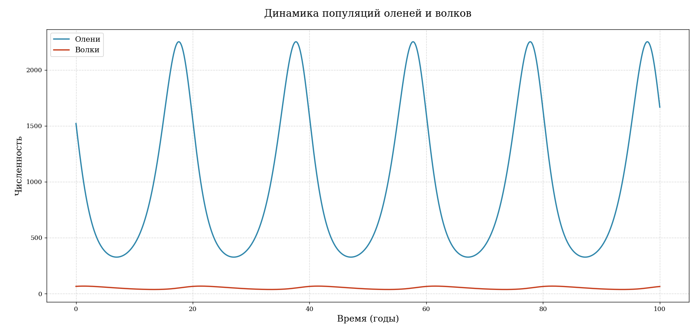

# Lotka-Volterra Deer-Wolf Model

A numerical study of predator-prey dynamics for deer and wolves in the Caucasus Nature Reserve. The project solves the Lotka-Volterra differential equations, checks their conserved quantity, and visualizes population cycles in two and three dimensions.

## Model

The system uses

```text
dx/dt = alpha*x - beta*x*y
dy/dt = delta*x*y - gamma*y
```

with an initial population of 1,521 deer and 65 wolves. The non-zero equilibrium is approximately 997 deer and 51 wolves.



## Quick start

```bash
python -m venv .venv
pip install -r requirements.txt
python lotka_volterra.py --output-dir artifacts
python -m pytest -q
```

The command creates population, phase-portrait, and 3D trajectory charts plus a JSON summary.

## Repository contents

- `lotka_volterra.py` - reproducible simulation and plotting CLI
- `tests/` - checks for positive populations and conservation-law stability
- `report/lotka_volterra_report.pdf` - full Russian-language research report
- `report/sources.docx` - source list used to estimate model parameters
- `report/` - original charts and editable report

The classical model intentionally omits migration, food limits, weather, disease, and human intervention. Its output should be treated as an educational approximation rather than an ecological forecast.

## License

MIT
